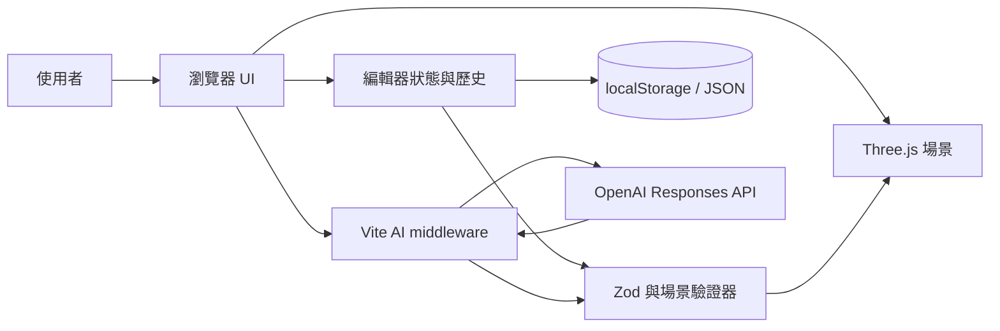

# FORMA 架構與技術決策

## 系統架構

FORMA 是瀏覽器端優先的單頁 3D 編輯器。Three.js 負責場景、相機、材質與模型；應用狀態以可序列化的 design JSON 表示。所有手動編輯、匯入方案及 AI 指令在套用前都經過相同的邊界、碰撞與 schema 驗證，避免畫面狀態和儲存資料分歧。

## 模組責任

| 區域 | 主要檔案 | 責任 |
|---|---|---|
| 應用組裝 | `src/main.js` | UI 事件、場景生命週期、歷史、還原與匯入匯出 |
| 3D 模型 | `src/models.js`、`src/room.js` | 家具幾何、房間、材質與燈光 |
| 空間規則 | `src/room-boundary.js`、`src/collisions.js`、`src/placement.js` | 房間邊界、路徑碰撞與空位搜尋 |
| 資料驗證 | `src/design-validation.js` | 方案 JSON 的信任邊界 |
| 編輯功能 | `src/object-editing.js`、`src/editor-features.js` | 多選、鎖定、儲存、測量與分享 |
| AI 前端 | `src/ai-panel.js`、`src/ai-commands.js` | 建立安全場景摘要、驗證並原子套用指令 |
| AI 後端 | `server/ai-service.js` | 保護金鑰、呼叫 Responses API、解析 Structured Outputs |

## 主要資料流

1. UI 操作產生候選變更。
2. schema 與空間規則驗證整份候選設計。
3. 驗證通過後才更新 Three.js 場景並建立一筆歷史紀錄。
4. 儲存與分享都從同一份可序列化狀態產生。
5. AI 僅回傳宣告式 JSON 指令；前端不執行模型生成的程式碼。任一指令失敗時整批回滾。

## 技術決策

### ADR-001：保留原生 JavaScript 模組

- **狀態：** 採用
- **原因：** 專案規模小，互動與 3D 邏輯比元件框架更核心；避免引入額外 runtime 與狀態同步層。
- **取捨：** UI 模板較集中，規模擴大時應再評估元件化。

### ADR-002：設計 JSON 是唯一可持久化來源

- **狀態：** 採用
- **原因：** 復原、localStorage、備份與 AI 都能共用同一驗證邊界。
- **取捨：** 匯入模型目前以 data URL 儲存，容量受瀏覽器限制；正式產品應改用資產 ID。

### ADR-003：AI 產生宣告式指令，不產生 JavaScript

- **狀態：** 採用
- **原因：** Structured Outputs 可限制命令集合，並讓既有場景驗證器成為最終裁決者。
- **取捨：** 能力受命令 schema 限制，但安全性、可測試性及回滾能力更高。

### ADR-004：AI 金鑰只存在伺服器端

- **狀態：** 採用
- **原因：** 防止瀏覽器 bundle 洩露金鑰；因此變數不使用 `VITE_` 前綴。
- **取捨：** 純靜態託管只能展示離線範例；完整 AI Demo 必須部署 Node/Vite middleware，並加上身分驗證與用量限制。

## 品質閘門

- Node 測試覆蓋模型、驗證、碰撞、儲存與 AI 錯誤情境。
- Playwright 在桌面與行動 Chromium 驗證核心 UI 流程。
- GitHub Actions 對每次 push 與 pull request 執行測試、正式建置及 E2E。
